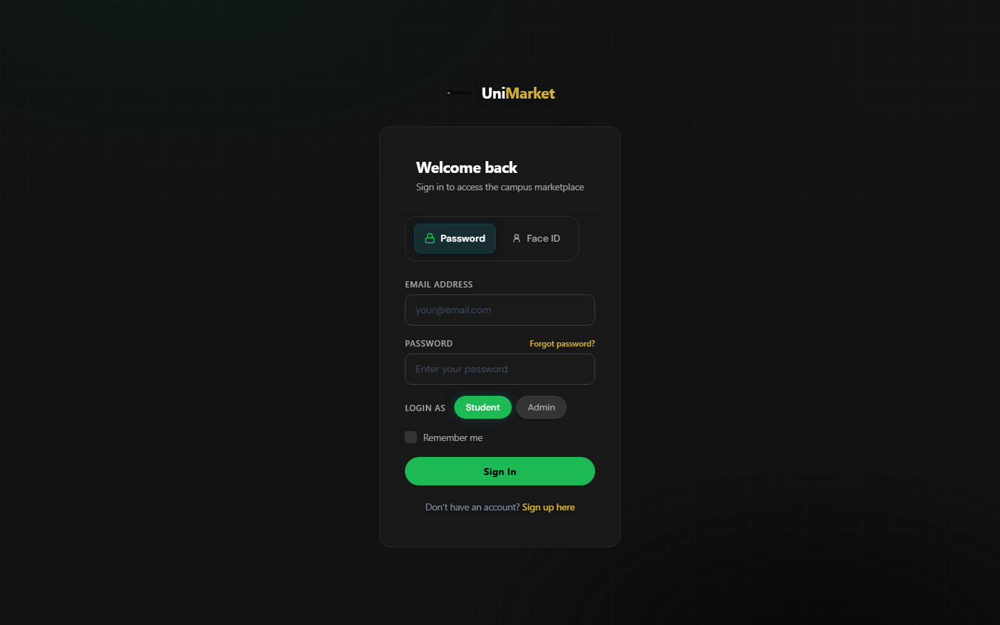
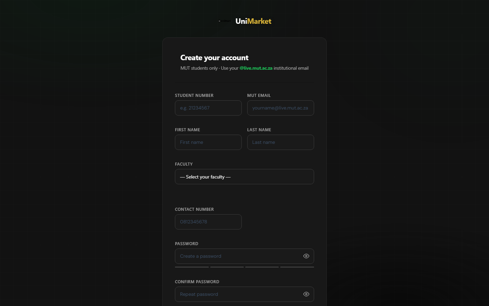
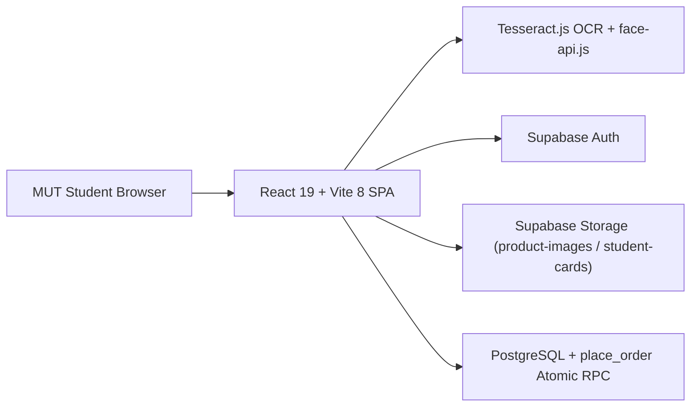

<div align="center">
  
  <h1>UniMarket v2</h1>
  <p>
    <strong>A closed peer-to-peer campus marketplace for MUT students with OCR student-card verification, live face matching, and atomic PostgreSQL checkout.</strong>
  </p>

  <p>
    
    
    
    
    <a href="LICENSE"></a>
  </p>

  <p>
    <a href="https://unimarket-frontend.onrender.com">Live Demo</a> •
    <a href="#-screenshots">Screenshots</a> •
    <a href="#-features">Features</a> •
    <a href="#%EF%B8%8F-architecture--tech-stack">Architecture</a> •
    <a href="#-getting-started">Getting Started</a>
  </p>
</div>

---

## What Is UniMarket v2?

**UniMarket v2** is a closed, student-only campus marketplace built for Mangosuthu University of Technology (MUT) students to buy and sell textbooks, electronics, and study supplies safely on campus.

Before a student can sign in or list an item, they pass a three-step identity gate: **Tesseract.js OCR** extraction from their physical student card, fuzzy-match validation against their institutional details (`@live.mut.ac.za`), and **live webcam face comparison** against the card photo—followed by admin verification. Checkout runs inside an atomic PostgreSQL RPC (`place_order`) to prevent double-bookings and race conditions on campus meetup slots.

---

## 📱 Screenshots

<table>
  <tr>
    <td align="center" width="50%">
      <br />
      <sub><strong>Dual-Path Authentication</strong> — Standard Supabase password login &amp; Face ID biometric tab</sub>
    </td>
    <td align="center" width="50%">
      <br />
      <sub><strong>Student Identity Gate</strong> — Institutional email, student card OCR &amp; face verification</sub>
    </td>
  </tr>
</table>

---

## ✨ Features

- **3-Step Identity Gate Registration**: Client-side **Tesseract.js v7** OCR reads student numbers from physical MUT ID cards, pairs with **`@vladmandic/face-api`** live face comparison, and queues accounts for admin approval.
- **Dual-Path Login**: Supports standard Supabase Auth email/password login alongside biometric Face ID verification (`Student` / `Admin` mode switch).
- **3-Step Sell Flow & Pre-Moderation**: Guided listing creation with multi-image Supabase Storage upload, campus meetup slot scheduling, and automated policy review.
- **Atomic Checkout (`place_order` RPC)**: Decrements listing quantities, reserves campus meetup slots, and writes order records in a single PostgreSQL transaction.
- **Admin Moderation Console**: Student approval queue, listing moderation, complaint resolution, and user status management.

---

## 🛠️ Architecture & Tech Stack



| Layer | Technology |
| --- | --- |
| **Frontend** | React 19, Vite 8, React Router DOM v7, Bootstrap 5.3, Tabler Icons |
| **Identity & Biometrics** | `tesseract.js` v7 (OCR), `@vladmandic/face-api` (face descriptor matching) |
| **Backend / BaaS** | Supabase (PostgreSQL, Auth, Storage, Transactional RPCs) |
| **Deployment** | Render Static Site ([`render.yaml`](render.yaml)) |

### Project Structure

```text
UniMarket_v2/
├── public/images/           # Campus imagery & face-api model weights
├── src/
│   ├── components/          # AuthContext, Navbar, ProtectedRoute
│   ├── pages/               # Login, Signup, Catalog, Sell, Activity, Review, Admin, Settings
│   ├── styles/              # Page-scoped stylesheets & design tokens
│   ├── utils/supabaseClient.js
│   ├── App.jsx
│   └── main.jsx
├── docs/screenshots/        # UI screenshots used in README
├── .env.example             # Supabase & optional PayFast env template
└── render.yaml              # Render blueprint
```

---

## 🚀 Getting Started

### Prerequisites
- **Node.js 18+**
- A **Supabase** project with tables (`students`, `products`, `product_images`, `meetup_slots`, `orders`, `complaints`, `face_descriptors`, `categories`, `admins`), `place_order` RPC, and `product-images` / `student-cards` buckets.

### 1. Clone, Configure & Run
```bash
git clone https://github.com/KevinAsanda/UniMarket_v2.git
cd UniMarket_v2
npm install
cp .env.example .env.local
```
Set `VITE_SUPABASE_URL` and `VITE_SUPABASE_ANON_KEY` in `.env.local`, then run:
```bash
npm run dev      # http://localhost:5173
npm run build    # Production static bundle in dist/
```

> **Note:** As an academic engineering showcase, client-side Face ID `sessionStorage` fallbacks and client-side AI review routes are documented for educational context and should be moved behind server-side Edge Functions for production hardening.

---

## 📄 License

Distributed under the **MIT License**. See [`LICENSE`](LICENSE) for details.
