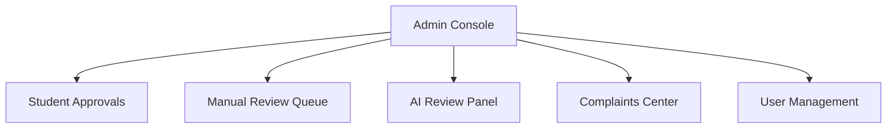

# Administration System

The admin console (`Admin.jsx`) gives administrators tools to verify student registrations, moderate product listings, resolve student complaints, and monitor platform activity. Access is gated to users in the `admins` table.

---

## 1. Analytics and Metrics Dashboard

On load, `Admin.jsx` fetches live database aggregates to populate stat cards at the top of the console:

- **Total Active Users**: Count of `students` rows where `account_status = 'active'`.
- **Active Listings**: Count of `products` where `status = 'available'` and `is_hidden = false`.
- **Unavailable Listings**: Count of `products` where `status IN ('sold', 'hidden', 'suspended')`.
- **Pending Complaints**: Count of `complaints` where `complaint_status = 'pending'`.
- **Top Sellers**: Aggregation of product counts grouped by `seller_id`, ranked descending.

---

## 2. Moderation Panels

The console is split into five tabbed panels:

---

### Panel A: Student Approvals

**Trigger**: Displays student rows where `account_status = 'pending'`.

**Workflow**:

1. The admin opens the card image overlay to inspect the uploaded student card photo retrieved from the `student-cards` Supabase Storage bucket.
2. The admin decides:
   - **Approve**: Updates `account_status` to `'active'`. The student can now log in via password or Face ID.
   - **Reject**: Prompts the admin for a rejection reason, then deletes the student profile from both the `students` table and `auth.users`.

---

### Panel B: Manual Listing Review Queue

**Trigger**: Displays `products` rows where `status = 'hidden'` and `is_hidden = true`. These are listings that the offline AI engine could not process or that were flagged for manual attention.

**Workflow**:

1. Admin reviews the listing name, description, price, category, and uploaded image.
2. The admin decides:
   - **Approve**: Updates `status` to `'available'` and `is_hidden` to `false`. The listing immediately appears in the student catalog.
   - **Reject**: Updates `status` to `'suspended'` and records the rejection reason. The listing remains invisible.

---

### Panel C: AI Content Review

**Trigger**: Admin manually initiates a scan of all currently active catalog listings.

**Workflow**:

1. Admin clicks **Run AI Review**. The panel loops through active listings and, for each one, calls the Anthropic Claude Sonnet API with the listing name, description, price, and image URL.
2. Claude returns a structured risk assessment.
3. Listings are displayed with a colour-coded risk flag:
   - **Low Risk** (green): No policy issues detected.
   - **Medium Risk** (amber): Suspicious pricing, ambiguous terms, or minor concerns.
   - **High Risk** (red): Potential banned keywords, signs of counterfeit goods, or scam characteristics.
4. The admin can view the full Claude analysis in a detail modal and click **Disable Listing** to immediately set `is_hidden = true`.

> **Current limitation**: The Claude API call is made directly from the client browser. This fails due to CORS restrictions and the absence of a server-held API key. See [`improvements-roadmap.md`](improvements-roadmap.md) for the Edge Function fix.

---

### Panel D: Complaints Center

**Trigger**: Fetches `complaints` rows where `complaint_status = 'pending'`.

**Workflow**:

1. The admin reviews the complaint description, the associated product, the order reference, and the seller contact details.
2. Clicking **Resolve** updates `complaint_status` to `'resolved'`. The complaint is removed from the active queue.

---

### Panel E: User Management

**Trigger**: Displays all registered students regardless of account status.

**Workflow**:

- **Ban**: Updates `account_status` to `'banned'`. The student is blocked from logging in. Any active session is invalidated on their next page load.
- **Unban**: Restores `account_status` to `'active'`.
