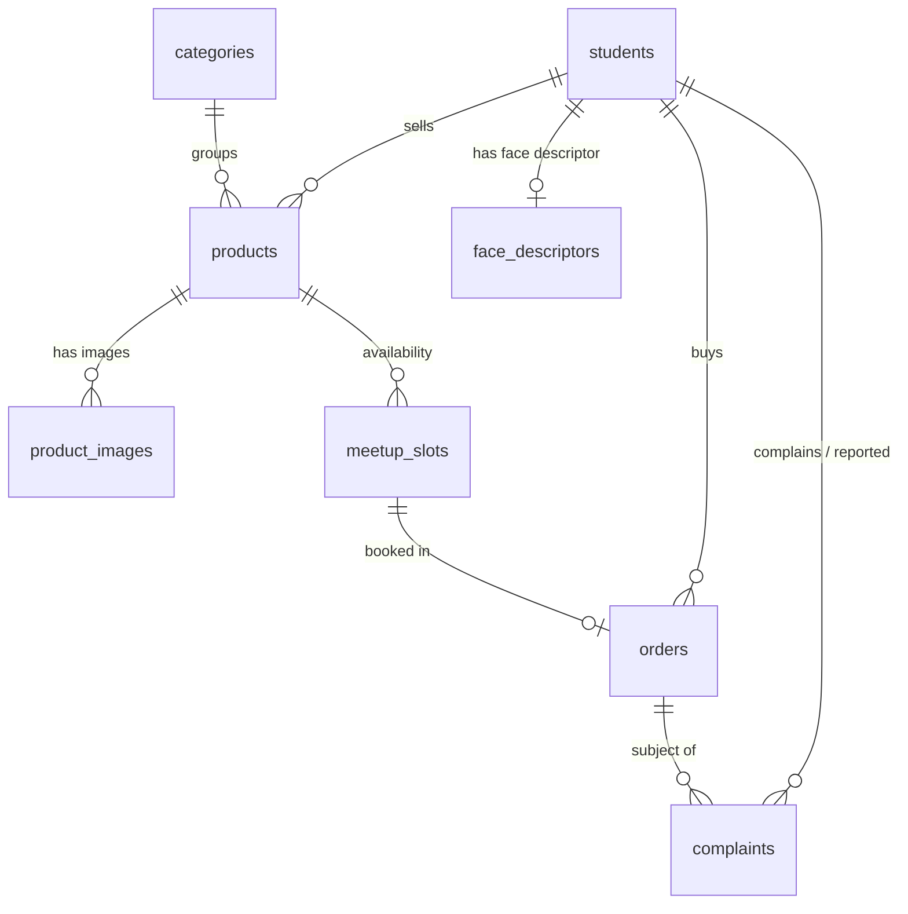

# Database Schema and Architecture

UniMarket v2 runs on a relational PostgreSQL database hosted on Supabase. This document covers the table definitions, entity relationships, and the transactional RPC function used for order placement.

---

## Entity Relationship Diagram



---

## Table Schemas

### 1. `students`
Stores the student accounts registered in the application.

| Column | Type | Constraints | Description |
| :--- | :--- | :--- | :--- |
| `student_id` | UUID | Primary Key, References `auth.users(id)` | Linked to Supabase Auth user |
| `student_number`| TEXT | NOT NULL, UNIQUE | Student university enrollment number |
| `first_name` | TEXT | NOT NULL | Student first name |
| `last_name` | TEXT | NOT NULL | Student surname |
| `email` | TEXT | NOT NULL, UNIQUE | Student email address |
| `contact_number`| TEXT | NOT NULL | Phone contact for transaction follow-ups |
| `qualification_id`| INTEGER | References `categories(category_id)` | Linked course faculty |
| `password` | TEXT | NOT NULL | Plain-text copy of user password (critical vulnerability) |
| `account_status`| TEXT | DEFAULT 'pending' | Status: `pending`, `active`, `suspended`, `banned` |
| `email_verified`| BOOLEAN | DEFAULT FALSE | Verified student email indicator |
| `face_verified` | BOOLEAN | DEFAULT FALSE | Face verification milestone completion indicator |
| `card_verified` | BOOLEAN | DEFAULT FALSE | OCR card check verification completion indicator |
| `card_image_url`| TEXT | NULLABLE | Supabase storage bucket public path for the card photo |

### 2. `products`
Defines items listed in the marketplace.

| Column | Type | Constraints | Description |
| :--- | :--- | :--- | :--- |
| `product_id` | UUID | Primary Key | Generated unique product identifier |
| `product_name` | TEXT | NOT NULL | Display name of the product |
| `description` | TEXT | NULLABLE | Product text details, condition details, etc. |
| `price` | NUMERIC | NOT NULL, Check: `price >= 0` | Price in South African Rand (ZAR) |
| `quantity` | INTEGER | NOT NULL, DEFAULT 1 | Available stock |
| `status` | TEXT | DEFAULT 'hidden' | Status: `available`, `sold`, `hidden`, `suspended` |
| `is_hidden` | BOOLEAN | DEFAULT TRUE | Visibility toggle on catalog |
| `seller_id` | UUID | References `students(student_id)` | FK linking to listing seller student |
| `category_id` | INTEGER | References `categories(category_id)` | FK linking product category |
| `created_at` | TIMESTAMPTZ | DEFAULT NOW() | Listing creation timestamp |

### 3. `product_images`
Links image URLs stored in the storage bucket to their respective products.

| Column | Type | Constraints | Description |
| :--- | :--- | :--- | :--- |
| `image_id` | BIGINT | Primary Key, Identity | Database generated identifier |
| `product_id` | UUID | References `products(product_id)` | Parent product reference |
| `storage_path` | TEXT | NOT NULL | Public url matching item photo in `product-images` |
| `is_primary` | BOOLEAN | DEFAULT FALSE | Primary display image indicator |

### 4. `meetup_slots`
Maintains availability timeframes proposed by sellers to meet up on campus for transactions.

| Column | Type | Constraints | Description |
| :--- | :--- | :--- | :--- |
| `slot_id` | BIGINT | Primary Key, Identity | Unique meetup slot reference |
| `product_id` | UUID | References `products(product_id)` | Linked product reference |
| `day_of_week` | TEXT | NOT NULL | Target weekday: `Monday` to `Sunday` |
| `slot_time` | TIME | NOT NULL | Time range, formatted `HH:MM` |
| `venue` | TEXT | NOT NULL | Pick up spot name (always located on MUT campus) |
| `is_booked` | BOOLEAN | DEFAULT FALSE | booked state indicator |

### 5. `orders`
Created when a buyer books a meetup slot to purchase an item.

| Column | Type | Constraints | Description |
| :--- | :--- | :--- | :--- |
| `order_id` | UUID | Primary Key | Generated unique transaction identifier |
| `product_id` | UUID | References `products(product_id)` | Product purchased |
| `buyer_id` | UUID | References `students(student_id)` | Student initiating checkout |
| `seller_id` | UUID | References `students(student_id)` | Owner of the listed product |
| `slot_id` | BIGINT | References `meetup_slots(slot_id)`| Chosen meetup reservation |
| `order_status` | TEXT | DEFAULT 'pending' | Status: `pending`, `completed`, `cancelled` |
| `created_at` | TIMESTAMPTZ | DEFAULT NOW() | Purchase transaction date |

### 6. `complaints`
Records disputes, scams, or policy violations reported by students.

| Column | Type | Constraints | Description |
| :--- | :--- | :--- | :--- |
| `complaint_id` | UUID | Primary Key | Generated complaint tracker identifier |
| `order_id` | UUID | NULLABLE, References `orders(order_id)` | Associated transaction, if the complaint relates to a completed order |
| `product_id` | UUID | References `products(product_id)` | FK linking the reported listing |
| `complainant_id`| UUID | References `students(student_id)` | The student filing the complaint |
| `reported_user_id`| UUID | References `students(student_id)`| Target student being complained about |
| `complaint_text`| TEXT | NOT NULL | Written description of the issue |
| `complaint_status`| TEXT | DEFAULT 'pending' | Status: `pending`, `resolved` |
| `created_at` | TIMESTAMPTZ | DEFAULT NOW() | Complaint timestamp |

### 7. `face_descriptors`
Stores facial landmark descriptor embeddings extracted via client-side face recognition during sign-up.

| Column | Type | Constraints | Description |
| :--- | :--- | :--- | :--- |
| `student_id` | UUID | Primary Key, References `students` | The owning student |
| `descriptor` | DOUBLE PRECISION[] | NOT NULL | 128-dimensional floating-point landmark descriptor array generated by `face-api.js` `faceRecognitionNet` |

### 8. `categories`
A simple lookup table for product category names (e.g. `Books`, `Electronics`, `Clothing`, `Stationery`). Linked to `products.category_id` and `students.qualification_id` (which maps to the student's faculty or course group).

### 9. `admins`
Holds administrator accounts used to access the moderation console. Columns: `admin_id` (UUID, PK), `email` (TEXT, UNIQUE), `password` (TEXT), `first_name` (TEXT), `last_name` (TEXT). Admin authentication is handled by a direct table query in `Login.jsx` rather than Supabase Auth.

---

## Transactional RPC Functions

### `place_order(p_product_id, p_buyer_id, p_slot_id)`
Due to the possibility of race conditions where multiple students attempt to book the same meetup slot or buy the same single-stock item simultaneously, purchases are executed atomically inside a PostgreSQL function (RPC) on the database server.

#### SQL Representation (Inferred Logic)
```sql
CREATE OR REPLACE FUNCTION place_order(
    p_product_id UUID,
    p_buyer_id UUID,
    p_slot_id BIGINT
) RETURNS JSON AS $$
DECLARE
    v_qty INT;
    v_seller_id UUID;
    v_status TEXT;
    v_slot_booked BOOLEAN;
    v_order_id UUID;
BEGIN
    -- 1. Locking rows for update to block race conditions
    SELECT quantity, seller_id, status INTO v_qty, v_seller_id, v_status
    FROM products
    WHERE product_id = p_product_id
    FOR UPDATE;

    SELECT is_booked INTO v_slot_booked
    FROM meetup_slots
    WHERE slot_id = p_slot_id
    FOR UPDATE;

    -- 2. Availability validation
    IF v_status = 'sold' OR v_qty <= 0 THEN
        RETURN json_build_object('success', false, 'message', 'Item is no longer available.');
    END IF;

    IF v_slot_booked THEN
        RETURN json_build_object('success', false, 'message', 'This meet-up slot has already been booked.');
    END IF;

    IF v_seller_id = p_buyer_id THEN
        RETURN json_build_object('success', false, 'message', 'Sellers cannot buy their own listings.');
    END IF;

    -- 3. Book slot
    UPDATE meetup_slots 
    SET is_booked = TRUE 
    WHERE slot_id = p_slot_id;

    -- 4. Decrement quantity and adjust status
    UPDATE products 
    SET quantity = quantity - 1, 
        status = CASE WHEN quantity - 1 <= 0 THEN 'sold' ELSE status END
    WHERE product_id = p_product_id
    RETURNING quantity INTO v_qty;

    -- 5. Create transaction order
    INSERT INTO orders (product_id, buyer_id, seller_id, slot_id, order_status)
    VALUES (p_product_id, p_buyer_id, v_seller_id, p_slot_id, 'pending')
    RETURNING order_id INTO v_order_id;

    RETURN json_build_object('success', true, 'order_id', v_order_id);
END;
$$ LANGUAGE plpgsql;
```
