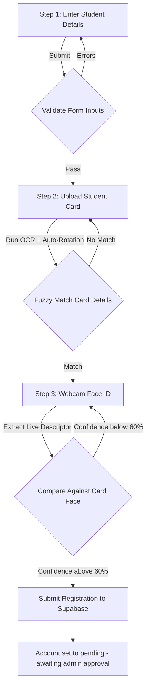

# User Flows and System Integration

This document traces the key user journeys through UniMarket v2, outlining the React component actions, security validations, and database interactions at each step.

---

## 1. Identity Validation and Registration Gate

To maintain a secure, closed campus environment, `Signup.jsx` enforces a three-step onboarding pipeline before any account is created.



### Step 1: Account Information

The student fills in: student number, email, first name, surname, faculty, course, phone number, and password. Client-side validation checks password strength and phone number format (10 digits).

### Step 2: Student Card OCR

- The student uploads a photo of their MUT student card.
- **Auto-rotation (`ocrBestRotation`)**: Tesseract.js tests four rotations (0, 90, 180, 270 degrees) and scores each by the frequency of matched university keywords (e.g. `MUT`, `Mangosuthu`, `Technology`, `Student`). The highest-scoring orientation is kept.
- **Fuzzy match (`verifyCardWithOCR`)**: The extracted text is compared against the form-submitted student number, first name, and surname within a fuzzy distance tolerance.

### Step 3: Face Landmark Comparison

- Three `face-api.js` model weights are loaded: `ssdMobilenetv1`, `faceLandmark68Net`, `faceRecognitionNet`.
- A reference descriptor is computed from the student card image.
- The live webcam feed is monitored in a loop. For each detected face, a descriptor is computed and the Euclidean distance to the reference is calculated:

$$\text{Confidence} = \max(0,\ 100 - (\text{Distance} \times 150))\%$$

- If confidence stays above 60% for a brief sustained period, the step passes.

### Step 4: Submission

1. `supabase.auth.signUp()` creates the Supabase Auth user with the provided email and password.
2. A profile row is inserted into `students` with `account_status: 'pending'`.

> **Security note**: The `password` field in the `students` table stores a plain-text copy of the user's password. This column should be removed before any production deployment. See [`security-and-architecture.md`](security-and-architecture.md) for the full remediation.

3. The student card image is uploaded to the `student-cards` Supabase Storage bucket.
4. The face descriptor array is inserted into `face_descriptors` linked to the student ID.
5. The student is redirected to login. They cannot access any protected route until an administrator sets their status to `active`.

---

## 2. Dual-Path Authentication

`AuthContext.jsx` implements session resolution across two authentication paths. The `resolveSession` function runs on every protected page load.

### Path A: Password Login

1. User enters email and password and selects a role (Student or Admin).
2. If role is Admin: the `admins` table is queried directly. On match, the session is established and the user is routed to `/admin`.
3. If role is Student: `supabase.auth.signInWithPassword()` is called.
4. The student profile is fetched from `students`. Account status is checked:
   - `suspended` or `banned`: session is signed out, sessionStorage is cleared, an error is shown.
   - `pending`: a warning screen blocks access.
   - `active`: the user is routed to `/` (Catalog).

### Path B: Face ID Login

1. The student enters their email and starts the Face ID flow.
2. Their profile is fetched from `students` to confirm the account is `active`, and their descriptor is loaded from `face_descriptors`.
3. The webcam activates and measures live face distance against the stored descriptor.
4. On a successful match, the student ID is written to `sessionStorage`:

```javascript
sessionStorage.setItem('um_student_id', studentId);
```

> **Security note**: Because `sessionStorage` is client-controlled, this value can be set manually in the browser console to impersonate any student. See [`security-and-architecture.md`](security-and-architecture.md) for the remediation path.

5. The user is routed to `/` (Catalog).

### Session Resolution

`resolveSession()` in `AuthContext.jsx` runs on every protected route mount:

```javascript
// 1. Try Supabase Auth session first
const { data: { session } } = await supabase.auth.getSession();
if (session?.user) {
  userId = session.user.id;
}

// 2. Fallback: Face ID sessionStorage session
if (!userId) {
  userId = sessionStorage.getItem('um_student_id') || null;
}

// 3. If neither exists, clear state and redirect to /login
```

`ProtectedRoute.jsx` wraps all student routes. If `user` is null after loading, it redirects to `/login`.

---

## 3. Product Listing Workflow

Sellers create listings through a three-step form in `Sell.jsx`.

- **Step 1 - Basics**: Item name, price (in ZAR), category, quantity, and description.
- **Step 2 - Image**: The image file is uploaded to the `product-images` Supabase Storage bucket. A row is inserted into `product_images` with the public URL and `is_primary: true`.
- **Step 3 - Meetup Slots**: The seller adds one or more pickup windows. Each window creates a row in `meetup_slots` with the day, time, venue, and `is_booked: false`.

On final submission, the product is created in `products` with `status: 'hidden'` and `is_hidden: true`. The seller is redirected to `Review.jsx`.

### AI Policy Scan (Review.jsx)

`Review.jsx` simulates a staged content review:

1. A mock "AI scanning" progress sequence runs with animated status transitions.
2. An offline rules engine checks the listing name and description against a `RULES.BANNED` list (weapons, drugs, counterfeit goods) and a `RULES.SUSPICIOUS` threshold list.
3. The verdict updates the product record in `products`:
   - **Approved**: `status: 'available'`, `is_hidden: false`. Listing goes live in the catalog.
   - **Flagged**: `status: 'hidden'`, `is_hidden: true`. Pushed into the admin's manual review queue.
   - **Rejected**: `status: 'suspended'`, `is_hidden: true`. Listing is permanently blocked.

---

## 4. Browse, Search, and Purchase Flow

### Browsing and Filtering

`Catalog.jsx` fetches all products where `status = 'available'` and `is_hidden = false`, joined with seller name from `students` and images from `product_images`. A search input triggers a client-side filter on product name and description.

### Purchase Flow

1. A student clicks **Buy** on a listing card (disabled if the listing belongs to them).
2. A modal opens showing product details and available meetup slots fetched from `meetup_slots` where `is_booked = false`.
3. The buyer selects a slot and clicks **Confirm Purchase**.
4. Before calling the RPC, `Catalog.jsx` re-fetches the product status to catch last-second availability changes.
5. A Supabase RPC call is made to `place_order(p_product_id, p_buyer_id, p_slot_id)`:
   - Locks the product and slot rows using `FOR UPDATE` to block race conditions.
   - Validates that the product is still available and the slot is not yet booked.
   - Decrements `quantity`, updates `status` to `'sold'` if quantity reaches zero.
   - Sets `meetup_slots.is_booked = true`.
   - Inserts an `orders` row with `order_status: 'pending'`.
   - Returns `{ success: true, order_id }` or a failure message.
6. On success, the toast notification confirms the booking and the catalog reloads.

### Reporting a Listing

Any student can report a listing they did not create. Clicking the flag button opens a report modal. On submission, a row is inserted into `complaints` with `complaint_status: 'pending'` for admin review.
